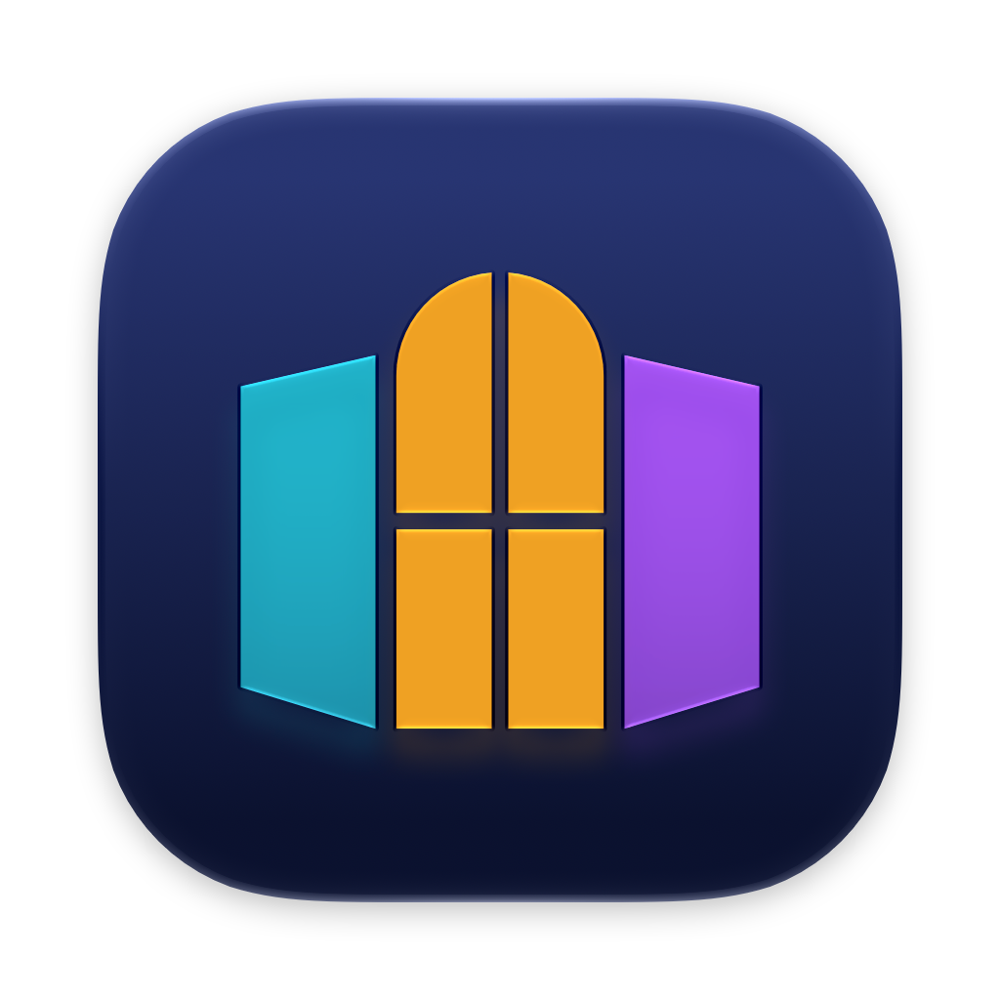
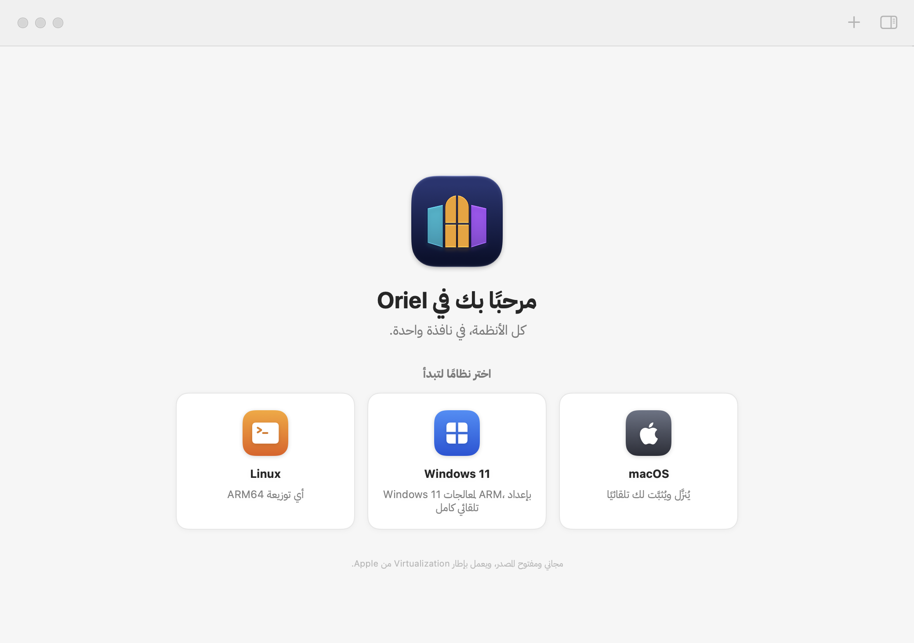
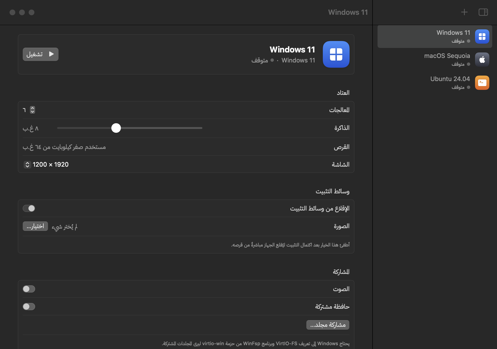
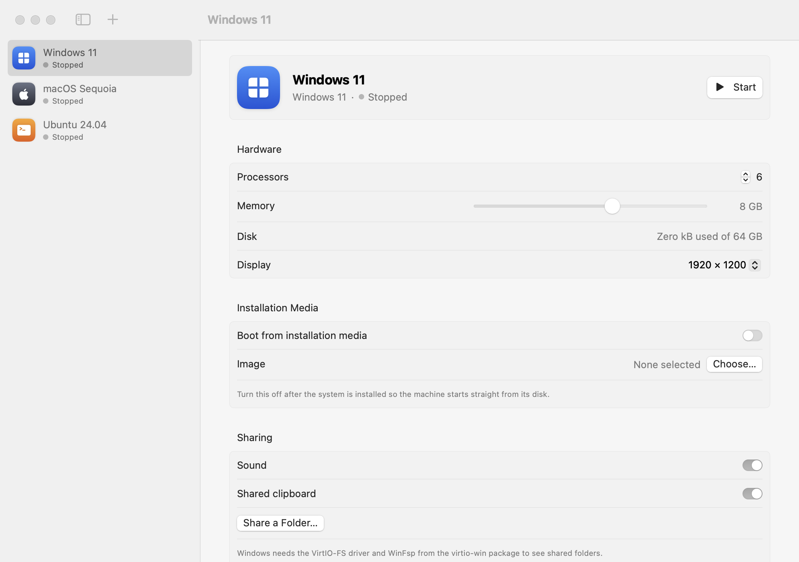
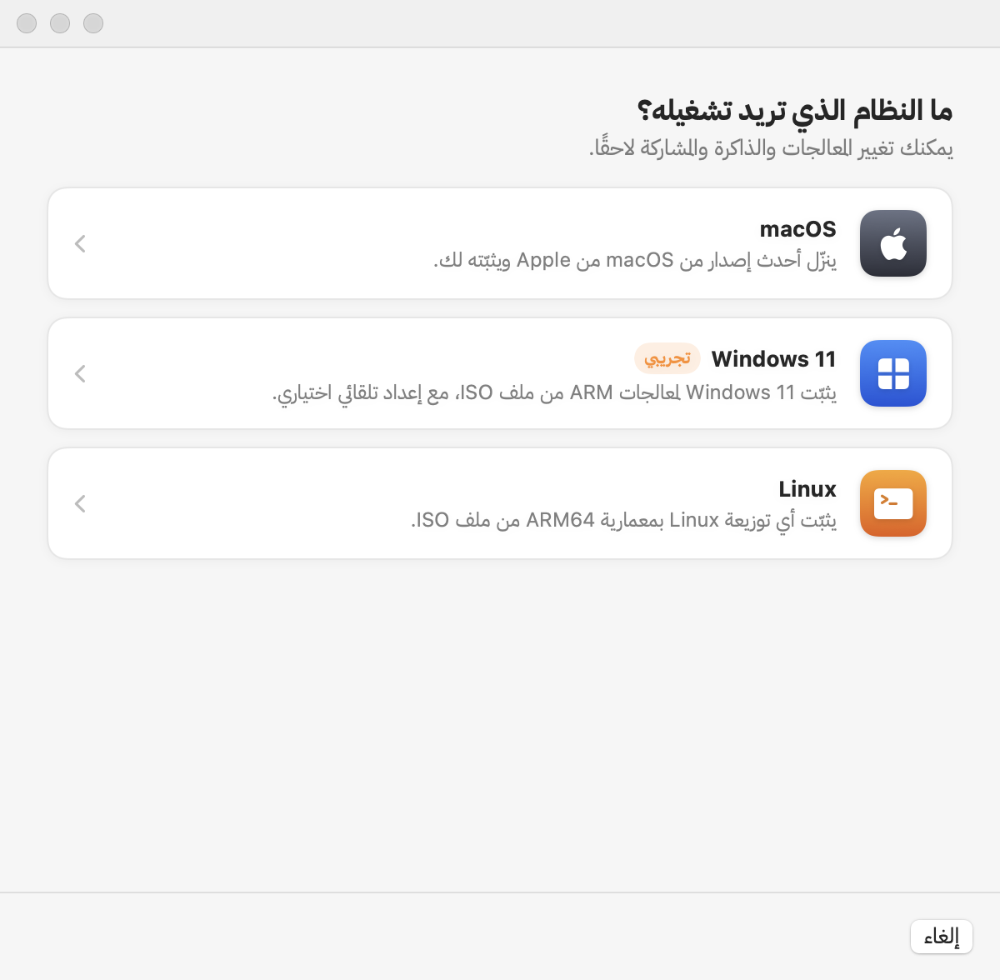
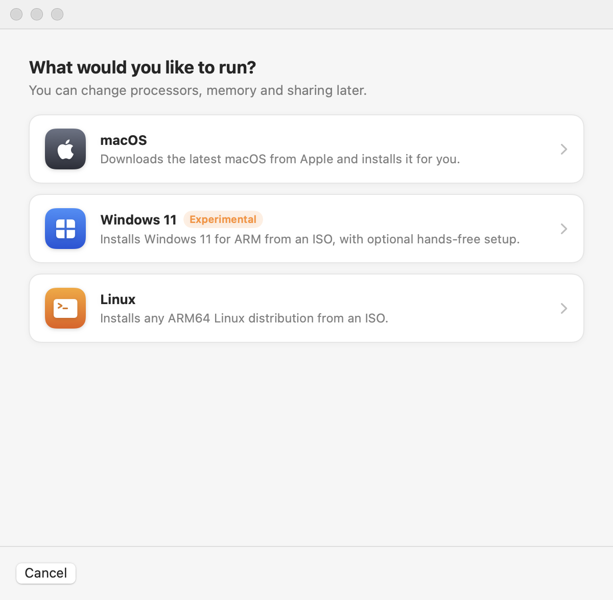

<div dir="rtl">

<p align="center"></p>

<h1 align="center">Oriel (أوريل)</h1>

<p align="center"><b>أجهزة افتراضية بأنظمة macOS وWindows وLinux على جهاز ماك. كل الأنظمة في نافذة واحدة.</b></p>

<p align="center"><a href="README.md">English</a></p>

<p align="center"></p>

**Oriel** تطبيق مجاني ومفتوح المصدر لتشغيل أجهزة افتراضية بأنظمة **macOS وWindows 11 وLinux** على أجهزة ماك بمعالجات Apple silicon. يعتمد فقط على إطار `Virtualization.framework` من Apple، دون امتدادات نواة أو QEMU أو خدمات خلفية. تطبيق SwiftUI أصلي صغير، بالعربية والإنجليزية.

## معنى الاسم

الاسم مأخوذ من *oriel window*، وهي النافذة البارزة من الجدار التي تطل على ثلاث جهات، مثل الروشان الحجازي في جدة القديمة. جهاز ماك واحد تطل منه على ثلاثة أنظمة.

## المزايا

- **macOS تلقائيًا بالكامل:** ينزّل أحدث نسخة رسمية من Apple ويثبّتها، وتتغيّر دقة الشاشة مع حجم النافذة.
- **Linux من أي ملف ISO بمعمارية ARM64:** مشاركة المجلدات عبر VirtioFS، ومشاركة الحافظة عبر `spice-vdagent`، وشاشة virtio-gpu تتغيّر مع النافذة، وسجل للمنفذ التسلسلي داخل حزمة كل جهاز.
- **Windows 11 لمعالجات ARM (تجريبي):** يُنشئ التطبيق ملف `Autounattend.xml` للتثبيت دون تدخل (يتجاوز فحص TPM وSecure Boot ويثبّت تعريف الشبكة من virtio-win عند أول تسجيل دخول)، ويستخدم قرص NVMe الذي يتعرّف عليه Windows دون تعريفات إضافية. حاليًا يتوقف مدير إقلاع Windows عند شاشة سوداء على إطار Apple، لذلك يظهر Windows في التطبيق بوصفه تجريبيًا. راجع [القيود](#القيود).
- **تعليق الجهاز واستئنافه:** احفظ الجهاز وهو يعمل وأكمل لاحقًا من حيث توقفت.
- **مشاركة المجلدات والحافظة:** مجلدات VirtioFS (تُركّب تلقائيًا في macOS) ومشاركة الحافظة عبر SPICE في Linux وWindows.
- **نسخ فوري:** كل جهاز مجلد `.oriel` مستقل، والنسخ يستخدم استنساخ APFS فلا تشغل النسخة مساحة إضافية حتى تتغيّر.
- **فحص ملف التثبيت مسبقًا:** يقرأ التطبيق صورة إقلاع UEFI داخل ملف ISO ويرفض مثبّتات x86-64 قبل تضييع وقتك.
- **العربية والإنجليزية:** اتجاه كامل من اليمين إلى اليسار، وخط IBM Plex Sans Arabic للنص العربي، واختيار اللغة من داخل التطبيق (الإعدادات)، مع دعم VoiceOver والتنقل بلوحة المفاتيح.

## لقطات الشاشة

| العربية | English |
|---|---|
|  |  |
|  |  |

اللقطات مولّدة من أجهزة تجريبية عبر الأمر `make snapshots`.

## المتطلبات

- جهاز ماك بمعالج Apple silicon (M1 أو أحدث)
- macOS 14 Sonoma أو أحدث
- للبناء: Xcode 26 أو أحدث (Swift 6.2)

## البناء والتشغيل

لا توجد إصدارات جاهزة بعد. ابنِ التطبيق من المصدر:

```bash
git clone https://github.com/a-khalid/oriel.git
cd oriel
make run
```

يبني الأمر `make run` الحزمة ويجمع `build/Oriel.app` ويوقّعه توقيعًا محليًا بصلاحية `com.apple.security.virtualization` ثم يفتحه. لا تعمل الأجهزة إلا من هذه الحزمة الموقّعة، لذا شغّل التطبيق بهذه الطريقة لا من زر Run في Xcode.

| الأمر | الوظيفة |
|---|---|
| `make app` | بناء نسخة التطوير |
| `make release` | بناء محسّن |
| `make run` | البناء ثم الفتح |
| `make test` | اختبارات الوحدات |
| `make lint-strings` | يفشل إن وُجد نص في الواجهة بلا ترجمة |
| `make smoke ISO=path/to/linux-arm64.iso` | إقلاع ملف ISO دون واجهة والتحقق من النجاح عبر المنفذ التسلسلي |
| `make snapshots` | رسم كل الشاشات بالعربية والإنجليزية في `build/snapshots` |
| `make icon` | إعادة بناء الأيقونة بعد تعديل `Support/Brand/AppIcon.icon` |

## دعم الأنظمة

| | macOS | Windows 11 ARM | Linux ARM64 |
|---|---|---|---|
| التثبيت | تنزيل أحدث IPSW من Apple وتثبيته | ملف ISO مع إعداد تلقائي اختياري | ملف ISO |
| الحالة | يعمل | **تجريبي**: لا يُقلع بعد | يعمل |
| الشاشة | Retina وتتغيّر مع النافذة | دقة ثابتة دون تسريع ثلاثي الأبعاد | virtio-gpu وتتغيّر مع النافذة |
| المجلدات المشتركة | VirtioFS تُركّب تلقائيًا | VirtioFS (تحتاج virtio-win وWinFsp) | VirtioFS (`mount -t virtiofs oriel /mnt`) |
| الحافظة | — | SPICE | SPICE (`spice-vdagent`) |
| التعليق والاستئناف | ✓\* | ✓\* | ✓\* |

\* على macOS 27.0.1 يرفض إطار Apple حفظ أي جهاز EFI بخطأ «permission denied». عندها يبقى الجهاز يعمل ويظهر الخطأ.

### تثبيت Windows 11 (تجريبي)

1. نزّل ملف **Windows 11 ARM64 ISO** من [موقع Microsoft](https://www.microsoft.com/software-download/windows11arm64).
2. اختياريًا: نزّل [`virtio-win.iso`](https://fedorapeople.org/groups/virt/virtio-win/direct-downloads/stable-virtio/virtio-win.iso) لتعريف الشبكة، ويثبّته التطبيق تلقائيًا عند أول تسجيل دخول.
3. اختر **جهاز افتراضي جديد ← Windows 11** وأبقِ خيار **إعداد Windows تلقائيًا** مفعّلًا.
4. عند ظهور عبارة *Press any key to boot from CD or DVD* انقر داخل النافذة واضغط أي مفتاح.
5. بعد الوصول إلى سطح المكتب أطفئ خيار **الإقلاع من وسائط التثبيت**.

لا يوفر الإطار شريحة TPM افتراضية، لذلك يتجاوز الإعداد التلقائي فحص TPM وSecure Boot. تفعيل Windows يحتاج ترخيصك الخاص. نرحّب بأي مساعدة لتجاوز الشاشة السوداء عند الإقلاع.

## البنية

- `Sources/OrielCore`: كل ما يتعامل مع Virtualization.framework، دون أي واجهة.
- `Sources/Oriel`: تطبيق SwiftUI (المكتبة، التفاصيل، معالج الجهاز الجديد، نافذة الجهاز، الإعدادات).
- `Sources/OrielSmoke`: أداة إقلاع دون واجهة يستخدمها `make smoke`.
- `Resources/<lang>.lproj`: الترجمات، و`Resources/Fonts` فيه خط IBM Plex Sans Arabic.
- `Experiments/hypervisor`: نموذج تجريبي لمشغّل أجهزة مبني على Hypervisor.framework، وليس جزءًا من التطبيق.

التفاصيل الكاملة في [README.md](README.md#architecture).

## القيود

هذه القيود من إطار Virtualization.framework نفسه:

- Windows 11 لا يُقلع بعد.
- لا تسريع للرسوميات ثلاثية الأبعاد أو DirectX في Windows.
- لا شبكة جسرية (Bridged)، فهي تحتاج صلاحية مقيّدة من Apple؛ يستخدم التطبيق NAT.
- لا تمرير لأجهزة USB.
- لا أنظمة بمعمارية x86/x64.

## خطة العمل

- إقلاع Windows 11 وإخراجه من الحالة التجريبية
- إصدارات موقّعة وموثّقة من Apple، وتثبيت عبر Homebrew
- لقطات متعددة لحالة الجهاز
- ترجمات إضافية

## المساهمة

نرحّب بكل المساهمات، ومنها الإبلاغ عن الأخطاء والترجمة. راجع [CONTRIBUTING.md](CONTRIBUTING.md)، وأبلغ عن الثغرات الأمنية بشكل خاص كما في [SECURITY.md](SECURITY.md).

## الترخيص

التطبيق مرخّص تحت [رخصة MIT](LICENSE)، وخطوط IBM Plex Sans Arabic المرفقة تحت [رخصة SIL Open Font License 1.1](Resources/Fonts/OFL.txt).

</div>
