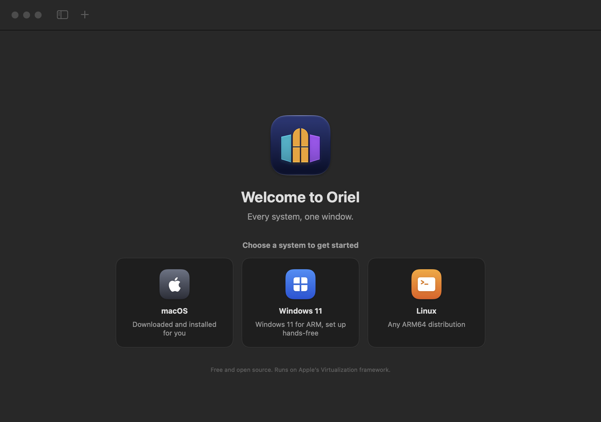

<p align="center"></p>

<h1 align="center">Oriel</h1>

<p align="center"><b>macOS, Windows and Linux virtual machines on your Mac. Every system, one window.</b></p>

<p align="center">
  <a href="https://github.com/a-khalid/oriel/actions/workflows/ci.yml"></a>
  
  
  <a href="LICENSE"></a>
</p>

<p align="center"><a href="README.ar.md">العربية</a></p>

<p align="center"></p>

**Oriel** is a free, open-source app for running **macOS, Windows 11 and Linux** virtual machines on Apple silicon Macs. It is built only on Apple's `Virtualization.framework`: no kernel extensions, no QEMU, no background daemons. One small native SwiftUI app, in English and Arabic.

## The name

An *oriel* is a bay window that projects from a wall and looks out three ways. In the Hijaz the same idea is the *rawashin*, the carved wooden window boxes of old Jeddah. Oriel gives your Mac that view: one window, three systems.

## Features

- **macOS guests, fully automatic.** Oriel downloads the latest restore image from Apple and installs it. The display is Retina and resizes with the window.
- **Linux guests from any ARM64 ISO.** VirtioFS shared folders, clipboard sharing through `spice-vdagent`, a resizable virtio-gpu display and a serial console log in every machine's bundle.
- **Windows 11 on ARM (experimental).** Oriel builds a hands-free `Autounattend.xml` (skips the TPM and Secure Boot checks, installs the virtio-win network driver at first logon) and attaches the disk as NVMe, which Windows supports out of the box. Today the Windows boot manager stops at a black screen on Virtualization.framework, so the app marks Windows as experimental. See [Limitations](#limitations).
- **Suspend and resume.** Save a running machine to disk and pick up where you left off.
- **Shared folders and clipboard.** VirtioFS folders (auto-mounted on macOS guests) and SPICE clipboard sharing for Linux and Windows.
- **Instant duplicates.** Every machine is a self-contained `.oriel` folder. **Duplicate** uses APFS clones, so a copy takes no extra space until it changes.
- **Checks your media first.** Oriel reads an ISO's UEFI boot image and refuses x86-64 installers before you waste a boot.
- **Arabic and English.** A full right-to-left layout, IBM Plex Sans Arabic for Arabic text, an in-app language picker (Settings), VoiceOver labels and keyboard navigation.

## Screenshots

| English | العربية |
|---|---|
|  |  |
|  |  |
|  |  |

The screenshots are generated from demo machines with `make snapshots`.

## Requirements

- A Mac with Apple silicon (M1 or later)
- macOS 14 Sonoma or later
- To build: Xcode 26 or later (Swift 6.2 toolchain)

## Build and run

Every merge into `main` publishes a disk image on the [Releases](https://github.com/a-khalid/oriel/releases) page. Until releases are notarized, allow the app under **System Settings → Privacy & Security → Open Anyway** on first launch.

Or build from source:

```bash
git clone https://github.com/a-khalid/oriel.git
cd oriel
make run
```

`make run` compiles the Swift package, assembles `build/Oriel.app`, signs it ad hoc with the `com.apple.security.virtualization` entitlement and opens it. Machines can only start from this signed bundle, so run the app this way rather than from Xcode's Run button.

| Command | What it does |
|---|---|
| `make app` | Debug build of `build/Oriel.app` |
| `make release` | Optimized build |
| `make dmg` | Optimized build packaged as `build/Oriel-<version>.dmg` |
| `make run` | Build and open the app |
| `make test` | Unit tests (`swift-testing`) |
| `make lint-strings` | Fail if a UI string lacks a translation |
| `make smoke ISO=path/to/linux-arm64.iso` | Boot an ISO headlessly; pass/fail from the serial console |
| `make snapshots` | Render every screen, English and Arabic, into `build/snapshots` (debug builds) |
| `make icon` | Recompile `Support/Icon/` after editing `Support/Brand/AppIcon.icon` (needs Xcode) |

`make smoke` boots the ISO through the same code the app uses and waits for `login:` on `/dev/hvc0`. The guest kernel must log to `console=hvc0`. Every EFI machine writes that console to `console.log` in its bundle.

To sign for distribution, run `SIGN_IDENTITY="Developer ID Application: …" make dmg`, then notarize the image. The [release workflow](.github/workflows/release.yml) does this automatically once its signing secrets are set.

## Guest support

| | macOS | Windows 11 ARM | Linux ARM64 |
|---|---|---|---|
| Install | Downloads the latest IPSW from Apple and installs it | ISO + optional hands-free setup (`Autounattend.xml`) | ISO |
| Status | Works | **Experimental**: does not boot yet | Works |
| Storage | VirtIO block | NVMe (driver built into Windows) | VirtIO block |
| Display | Retina, resizes with the window | UEFI framebuffer (fixed resolution, no 3D) | virtio-gpu, resizes |
| Shared folders | VirtioFS, auto-mounted | VirtioFS (needs virtio-win + WinFsp) | VirtioFS (`mount -t virtiofs oriel /mnt`) |
| Clipboard | — | SPICE agent | SPICE agent (`spice-vdagent`) |
| Suspend / resume | ✓\* | ✓\* | ✓\* |
| Sound output | ✓ | driver dependent | ✓ |

\* On macOS 27.0.1, Virtualization.framework rejects saving any EFI machine with "permission denied", even a minimal one outside Oriel. When a suspend fails, Oriel keeps the machine running and shows the error.

### Linux

Pick any ARM64 (aarch64) installer ISO, for example Ubuntu Server or Fedora for ARM. To share a folder, add it in the machine's settings and run `sudo mount -t virtiofs oriel /mnt` in the guest. Install `spice-vdagent` for clipboard sharing.

### Windows 11 (experimental)

1. Download the **Windows 11 ARM64 ISO** from [Microsoft](https://www.microsoft.com/software-download/windows11arm64).
2. Optional: download [`virtio-win.iso`](https://fedorapeople.org/groups/virt/virtio-win/direct-downloads/stable-virtio/virtio-win.iso). It provides the network driver, which Oriel installs automatically at first logon.
3. In Oriel, choose **New Virtual Machine → Windows 11** and keep **Set up Windows automatically** on.
4. When the window shows *Press any key to boot from CD or DVD*, click inside it and press a key.
5. After you reach the desktop, turn off **Boot from installation media** in the machine's settings.

Virtualization.framework has no virtual TPM, so automatic setup bypasses the Windows 11 TPM and Secure Boot checks. Windows still needs your own license to activate. Help getting the boot manager past its black screen is very welcome.

## Architecture

```
Sources/
  OrielCore/            no UI; everything that touches Virtualization.framework
    Model/                VMSpec (config.json), VMBundle (on-disk layout), VMLibrary, DiskImage
    Engine/               ConfigurationBuilder (spec → VZVirtualMachineConfiguration), HostResources
    Install/              MacOSInstaller, RestoreImageDownloader, WindowsUnattend,
                          InstallMediaBuilder, BootArchitecture (ISO architecture check)
    Runtime/              VMSession (one live machine, @MainActor), main-queue wrappers
  Oriel/                SwiftUI app: library, detail, new-machine wizard, machine window, settings
  OrielSmoke/           oriel-smoke: headless boot check used by `make smoke`
Tests/OrielCoreTests/     unit tests for OrielCore
Resources/<lang>.lproj    translations; Resources/Fonts holds IBM Plex Sans Arabic (OFL)
Support/                  Info.plist, entitlements, compiled icon; Brand/AppIcon.icon is its Icon Composer source
Experiments/hypervisor/   oriel-hv, a learning prototype VMM on Hypervisor.framework (not part of the app)
```

Virtualization.framework requires every call to a machine to happen on the queue that created it. Oriel creates machines on the main queue, keeps `VMSession` on `@MainActor`, and calls the framework's completion-handler APIs through `VZMainQueue.swift` instead of its nonisolated `async` overlays.

Machines live in `~/Library/Application Support/Oriel/Virtual Machines`. Each `.oriel` bundle holds `config.json`, the disk image, the EFI variable store, the machine identifier and, for macOS guests, the auxiliary storage.

## Limitations

These come from Virtualization.framework itself, not from Oriel:

- Windows 11 does not boot yet (see above).
- No DirectX/3D acceleration for Windows guests.
- No bridged networking (it needs a restricted entitlement from Apple); Oriel uses NAT.
- No USB device passthrough.
- No x86/x64 guests: Apple silicon virtualizes ARM64 only.

## Roadmap

- Get Windows 11 past the boot manager and out of experimental status
- Signed, notarized releases and a Homebrew cask
- Snapshots of machine state beyond a single suspend
- More translations

`Experiments/hypervisor` explores a Hypervisor.framework backend, where every device is Oriel's own code. It could one day lift some of the limits above, such as a custom GPU for Windows.

## Contributing

Contributions of every size are welcome: bug reports, fixes, docs and translations. Read [CONTRIBUTING.md](CONTRIBUTING.md) to get started. Please report security issues privately as described in [SECURITY.md](SECURITY.md).

## License

Oriel is released under the [MIT License](LICENSE). The bundled IBM Plex Sans Arabic fonts are under the [SIL Open Font License 1.1](Resources/Fonts/OFL.txt).

Oriel is not affiliated with Apple or Microsoft. macOS is a trademark of Apple Inc.; Windows is a trademark of Microsoft Corporation.
